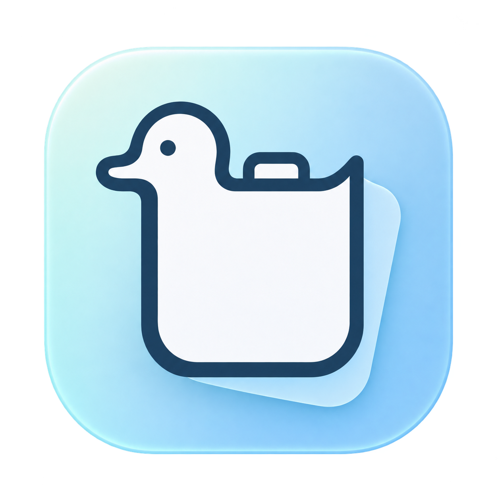

<p align="center">
  
</p>
<h1 align="center">ClipNest</h1>
<p align="center">原生 macOS 剪贴板历史工具。找回复制过的内容，用键盘快速粘贴。</p>
<p align="center">
  <a href="https://github.com/MongoRolls/clipnest/releases">发行版本</a> ·
  <a href="docs/USAGE.md">使用指南</a> ·
  <a href="CHANGELOG.md">更新记录</a>
</p>

## 功能

- **找回和收藏**：记录文本、图片和文件路径，常用内容可以收藏并拖动排序。普通历史默认保留最近 50 条，可在设置中调整。
- **键盘优先**：按 `⌘⇧V` 在指针旁打开历史，搜索、预览、复制或粘贴。支持纯文本，也可保留 HTML/RTF 格式。
- **搜图片里的字**：用 Apple Vision 在本机识别图中文字，支持关键词、来源应用、内容类型和正则搜索。
- **控制记录范围**：可暂停收录、排除应用或关闭后台图片识别，支持简体中文、英语和深浅外观。

## 安装

需要 **macOS 13 或更新版本**。通用构建支持 Apple Silicon 与 Intel。

- 若 [Releases](https://github.com/MongoRolls/clipnest/releases) 的 Assets 提供 `ClipNest-macOS-universal.zip`，下载解压后，将 `ClipNest.app` 拖入「应用程序」。
- 如果只看到 GitHub 自动生成的 **Source code**，那是源码，不是安装包。可按下方步骤本地构建。签名和公证说明见 [分发指南](docs/DISTRIBUTION.md)。

## 快速上手

启动 ClipNest 后，复制一段文字，再按 `⌘⇧V` 或从菜单栏选择「显示历史」。输入关键词，选中记录后按回车。

| 默认快捷键 | 操作 |
| --- | --- |
| `⌘⇧V` | 打开历史面板 |
| `⌘F` | 聚焦搜索框 |
| `↑` / `↓`、`Enter` | 选择并取用记录 |
| `⇧Enter` | 默认以纯文本复制；选中图片时提取文字 |
| `⌘I` | 打开或关闭详情预览 |
| `⌘D` / `⌘L` | 收藏或取消收藏 / 切换历史与收藏 |
| `⌘,` | 打开设置 |

默认会尝试粘贴到原应用，这需要 macOS「辅助功能」权限。不授权或关闭「直接粘贴到当前应用」时，仍可复制到系统剪贴板后手动粘贴。搜索可以试试 `type:image 错误` 或 `@访达 关键词`，更多语法见 [使用指南](docs/USAGE.md#面板搜索)。

## 数据与隐私

剪贴板历史只存本机，图片识别也在本机完成。数据位于 `~/Library/Application Support/ClipNest/`：正文、图片、文件路径和 OCR 文本等内容使用 AES-GCM 加密，密钥存于当前用户的钥匙串。时间、类型等部分元数据不加密。

默认排除「钥匙串访问」和「密码」，但来源识别不等于识别所有敏感内容，复制敏感信息前可以主动暂停记录。降级到只支持数据库 v3 的旧版可能显示空历史，详见 [使用指南](docs/USAGE.md#记录与隐私)。

## 从源码构建

使用 Swift 和 AppKit，无第三方依赖。完整构建需要带 **macOS 26 或更新 SDK** 的 Xcode 或 Command Line Tools；这与应用的最低运行版本不同。

在仓库根目录运行：

```sh
bash macOS/build.sh
open artifacts/macos/ClipNest.app
```

默认产物是本地开发签名的通用应用和 ZIP，不代表已完成 Developer ID 签名或 Apple 公证。更多见 [构建与验证说明](docs/USAGE.md#构建和验证-macos) 和 [历史验证记录](docs/VERIFICATION.md)。

## 致谢

菜单栏面板和键盘交互的设计参考 [Maccy](https://github.com/p0deje/Maccy)。
